<div align="right">
  <a href="https://unigrant.vercel.app/" target="_blank">
    
  </a>
  <br/>
  🌐 <a href="https://unigrant.vercel.app/" target="_blank"><strong>https://unigrant.vercel.app/</strong></a>
</div>

<div align="center">

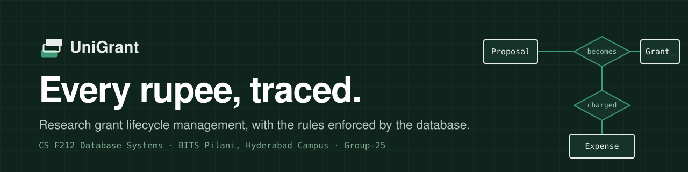

<br/>

**A full-stack database application for the whole life of a university research grant:<br/>proposal, review, award, budgets, expenses, milestones and research outputs.**

<br/>


**CS F212 Database Systems · BITS Pilani, Hyderabad Campus · Group-25**

[Quick start](#quick-start) · [Workflows](#three-end-to-end-workflows) · [Database](#database-design) · [Team](#team-and-contributions) · [Documentation](#documentation) · [Design document (PDF)](docs/reports/Group-25_Database_Design.pdf)

</div>

---

## The idea

A research grant passes through many hands, and the costly mistakes are always the same: a budget overspent, a receipt claimed twice, a milestone missed. UniGrant keeps the whole life of a grant in one relational database, and the rules that matter most are **enforced by the DBMS itself** through constraints and triggers, so they hold no matter which client touches the data.

<table>
<tr>
<td width="50%">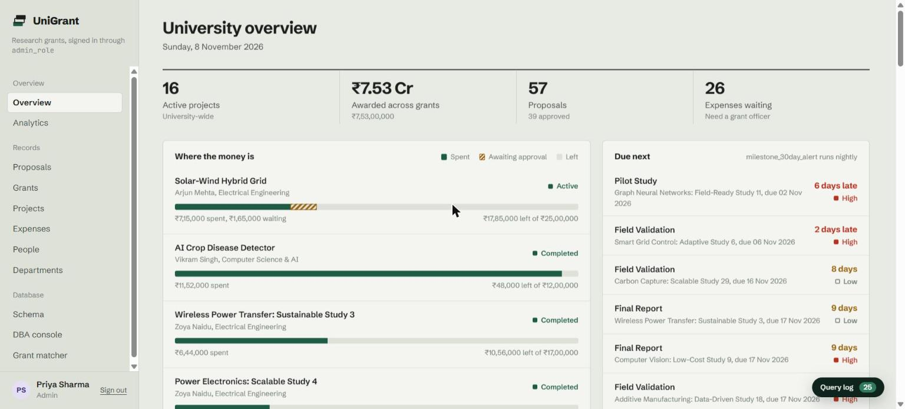<br/><sub><b>University overview.</b> Spent, awaiting approval and remaining funds per project.</sub></td>
<td width="50%">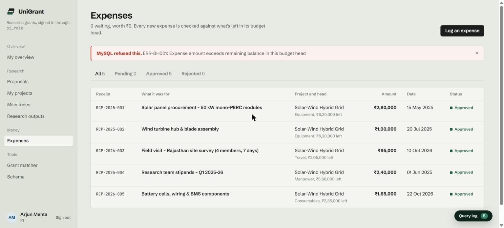<br/><sub><b>The database says no.</b> <code>ERR-BH001</code> comes straight from a trigger, not from JavaScript.</sub></td>
</tr>
</table>

## At a glance

| | | | |
|:-:|:-:|:-:|:-:|
| **19** relations | **11** CHECK constraints | **24** foreign keys | **1,335** seed records |
| **5** triggers | **4** views | **6** secondary indexes | **4** MySQL roles |
| **2** stored procedures | **3** scheduled events | **6** analytical queries | **32** integration tests |

## Technology stack

| Layer | Technology |
|---|---|
| **Database** | MySQL 8.0 on InnoDB: CHECK, roles, generated columns, CTEs, window functions, FULLTEXT, events |
| **Backend** | Node.js, Express 4, `mysql2/promise` (pooled, parameterised queries) |
| **Frontend** | React 19, Vite 8, GSAP, Three.js (3D Chen-notation explorer) |
| **Security** | SHA-256 password hashing, HMAC-signed session tokens, API role guard, least-privilege MySQL roles |
| **Testing** | Node's built-in test runner against a real MySQL server |

## Architecture

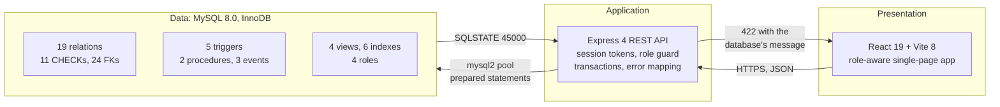

Business rules live in the data tier. The API authenticates, applies row filters, runs transactions and turns database errors into HTTP responses, so a refusal from a trigger is exactly what the user reads.

## Quick start

**You need:** Node.js 22 or newer, and MySQL 8.0 (local or Docker).

**1. Clone and install**

```bash
git clone https://github.com/BinaryCoder3012/DBMS-Project.git
cd DBMS-Project
npm install
npm install --prefix server
```

**2. Load the database**

> [!WARNING]
> This drops and recreates the `unigrant` database.

```bash
mysql -u root -p < unigrant_schema.sql
```

<details>
<summary>Using Docker instead</summary>

```bash
docker run -d --name unigrant_mysql -e MYSQL_ROOT_PASSWORD=root -p 3306:3306 mysql:8.0
# wait about 20 seconds for the first start, then:
docker exec -i unigrant_mysql mysql -uroot -proot --default-character-set=utf8mb4 < unigrant_schema.sql
```

</details>

<details>
<summary>Loading the files one at a time</summary>

```bash
mysql -u root -p < schema/01_schema_er.sql
mysql -u root -p < schema/02_views_indexes.sql
mysql -u root -p < schema/03_triggers_integrity.sql
mysql -u root -p < schema/04_rbac.sql
mysql -u root -p < schema/05_stored_procs_events.sql
mysql -u root -p --default-character-set=utf8mb4 < schema/06_seed_data.sql
mysql -u root -p --default-character-set=utf8mb4 < schema/07_seed_bulk.sql
```

</details>

**3. Configure the API**

```bash
cp server/.env.example server/.env   # then set DB_USER, DB_PASS, DB_PORT and AUTH_SECRET
```

**4. Run it, in two terminals**

```bash
npm run server   # API on http://localhost:3001
npm run dev      # app on http://localhost:5173
```

**5. Sign in**

| Role | Email | Password | Try |
|---|---|---|---|
| Admin | `priya@university.edu` | `admin123` | Analytics, DBA console, Q1 to Q6 |
| PI | `arjun@university.edu` | `pi123` | Log an expense, write a proposal |
| PI | `vikram@university.edu` | `pi456` | Another PI's view of the data |
| Grant Officer | `sneha@university.edu` | `go123` | Approve expenses, award a grant |
| Student | `rahul@university.edu` | `student123` | Assigned projects, no money |
| Student | `anjali@university.edu` | `student456` | Assigned projects, no money |

Every generated user signs in with the password `demo123`. If the app cannot reach the API or database, it falls back to a small built-in preview, and nothing you change there reaches MySQL.

**6. Run the tests**

```bash
mysql -u root -p < unigrant_schema.sql   # the tests change rows, so start fresh
npm test
```

## Three end-to-end workflows

Each one exercises a different part of the database. The [workflow guide](docs/workflows.md) has sequence diagrams.

### W1: Award a grant, a multi-table transaction

A PI drafts and submits a proposal. A grant officer reviews and awards it. **One transaction** approves the proposal and inserts the `Grant_`, `Project` and `BudgetHead` rows. If any row is refused, none of them stay.

### W2: Submit and approve an expense, integrity enforcement

A PI logs an expense, and triggers refuse an overspend (`ERR-BH001`) or a repeated receipt (`ERR-EXP001`). Approval takes row locks, and an `AFTER UPDATE` trigger moves the money in the same transaction. Six simultaneous approvals on one head cannot overspend it: three pass and three are refused, and a test proves it.

### W3: Discover and report, complex retrieval

FULLTEXT search matches researchers to topics and scores open funding calls into `MATCHES`. Analytics read from views, annual reports come from a stored procedure, and Q1 to Q6 run live in the DBA console.

<table>
<tr>
<td width="50%">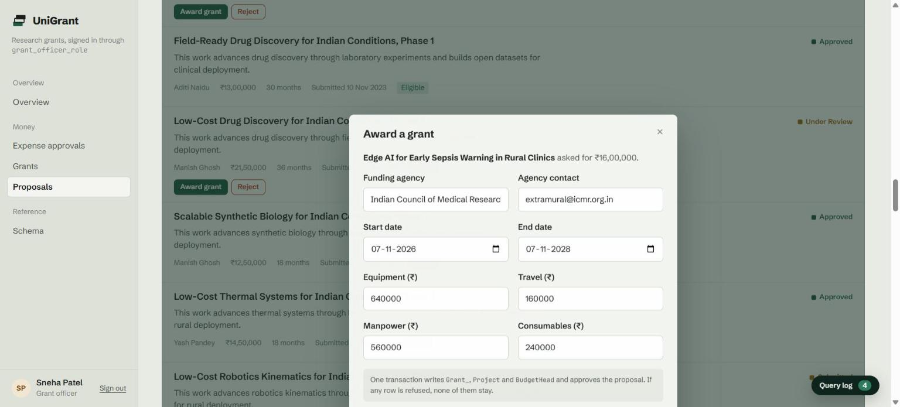<br/><sub><b>W1.</b> The award writes four tables in one transaction.</sub></td>
<td width="50%">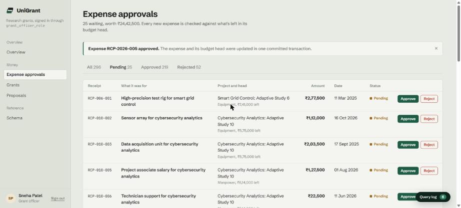<br/><sub><b>W2.</b> A grant officer's approval queue.</sub></td>
</tr>
<tr>
<td width="50%">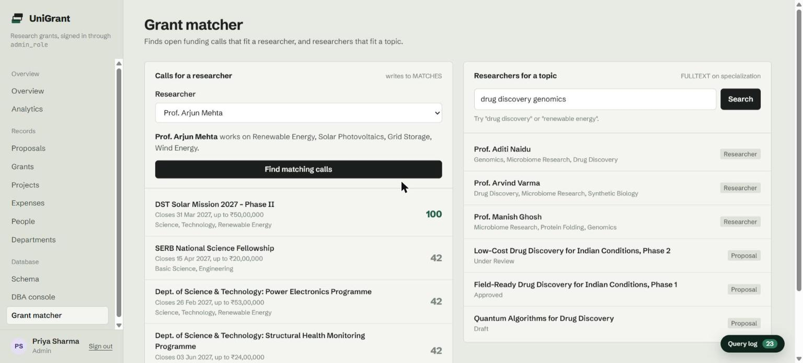<br/><sub><b>W3.</b> FULLTEXT relevance ranks calls and researchers.</sub></td>
<td width="50%">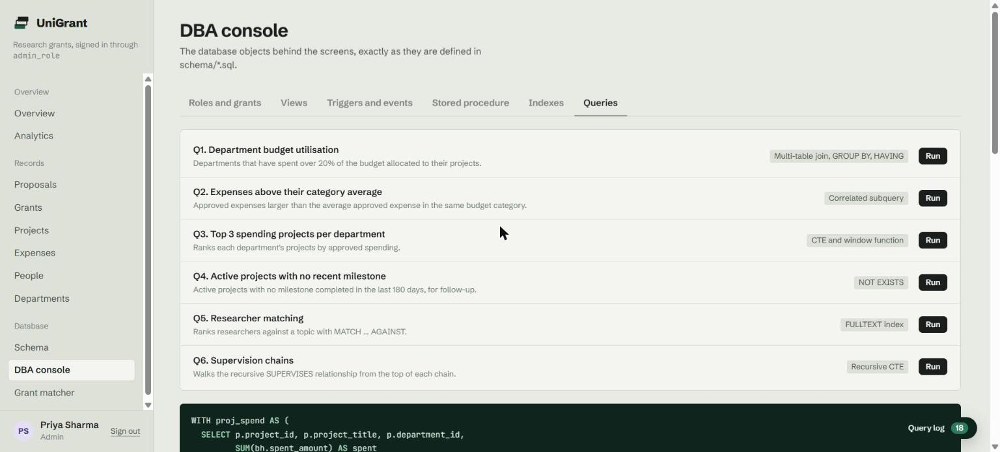<br/><sub><b>W3.</b> Q1 to Q6 run live, and the console shows SQL straight from <code>schema/</code>.</sub></td>
</tr>
</table>

## Database design

### EER model (Chen notation)

The model has 12 strong entities, 3 weak or associative entities with composite keys (`Dependent`, `Equipment`, `PublicationAuthor`), 3 M:N relationships with attributes (`WORKS_ON`, `MATCHES`, recursive `SUPERVISES`) and one specialisation of `User` by `role`.

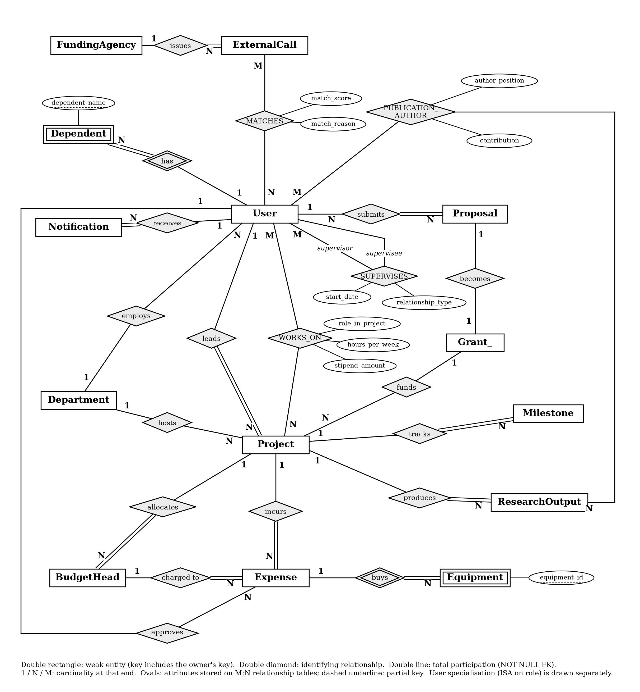

<details>
<summary><b>Crow's foot views with attributes</b></summary>

<br/>

**Organisation, people and external funding**

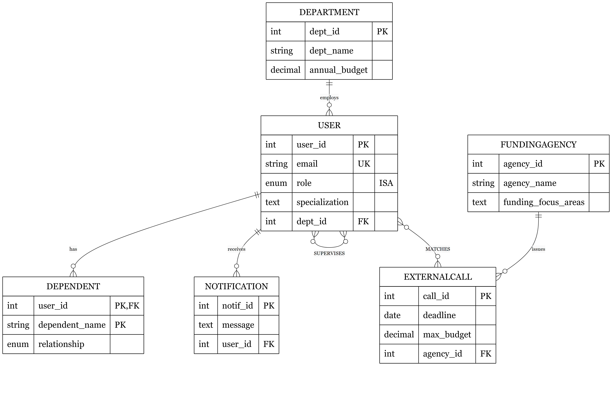

**Proposal to grant to project**

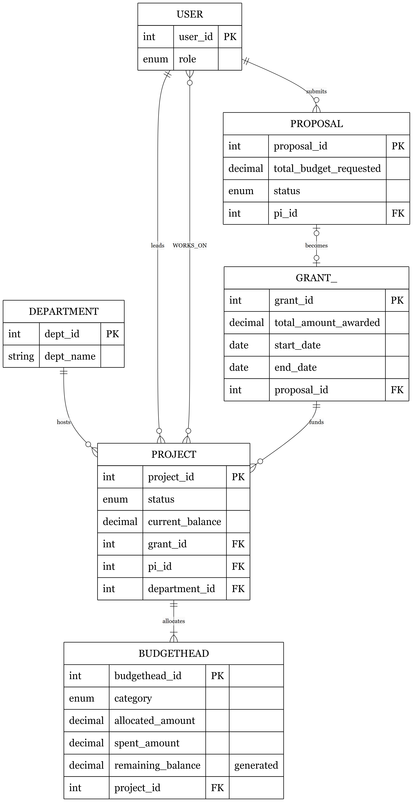

**Spending, milestones and research outputs**

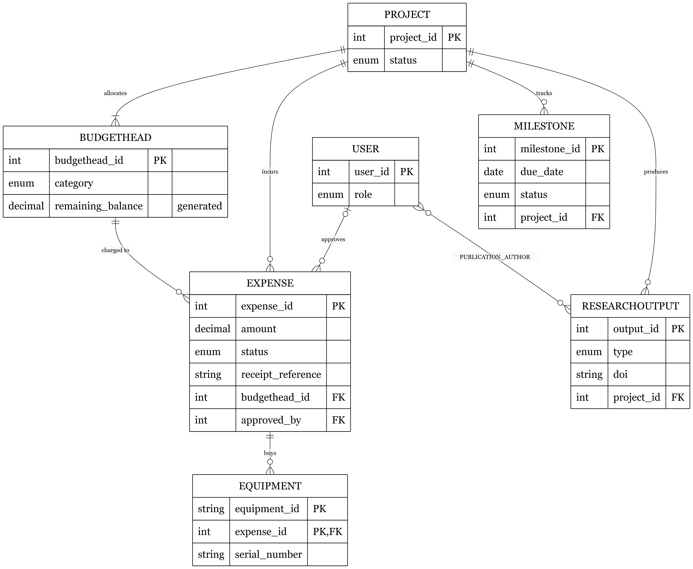

**Specialisation of User**

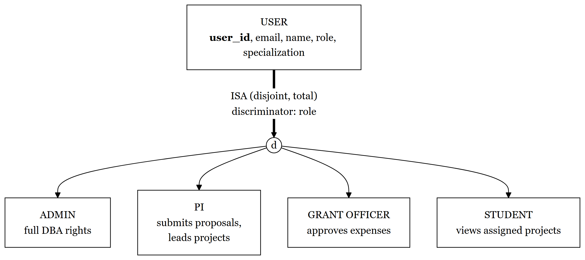

</details>

<details>
<summary><b>The same model as an ER diagram</b></summary>

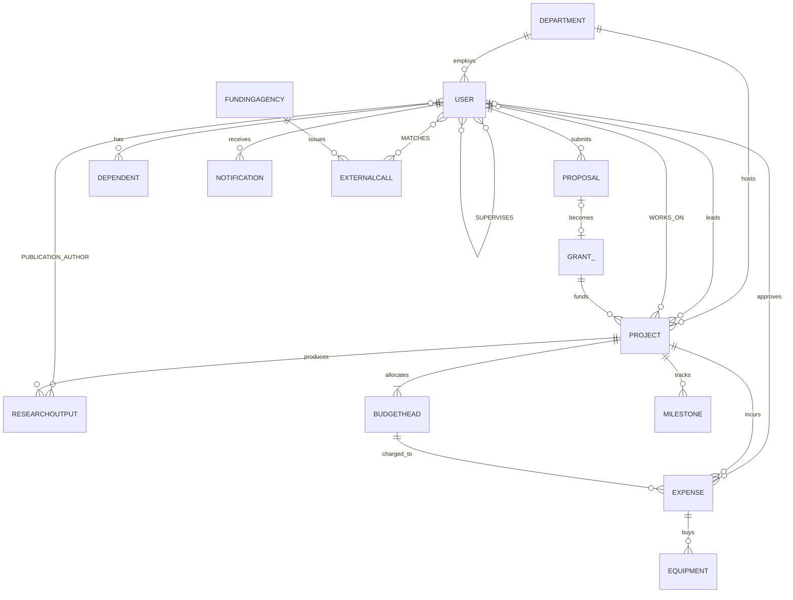

</details>

### Relational schema

<details>
<summary><b>All 19 relations with keys and referential actions</b></summary>

| Relation | Primary key | Foreign keys (ON DELETE) |
|---|---|---|
| Department | dept_id | none |
| User | user_id | dept_id → Department (SET NULL); UNIQUE email, ssn |
| FundingAgency | agency_id | none |
| ExternalCall | call_id | agency_id → FundingAgency (CASCADE) |
| Proposal | proposal_id | pi_id → User (RESTRICT) |
| Grant_ | grant_id | proposal_id → Proposal (SET NULL); UNIQUE proposal_id |
| Project | project_id | department_id → Department (SET NULL); grant_id → Grant_ (SET NULL); pi_id → User (RESTRICT) |
| BudgetHead | budgethead_id | project_id → Project (CASCADE) |
| Expense | expense_id | budgethead_id → BudgetHead (RESTRICT); project_id → Project (CASCADE); approved_by → User (SET NULL) |
| Milestone | milestone_id | project_id → Project (CASCADE) |
| ResearchOutput | output_id | project_id → Project (CASCADE) |
| Notification | notif_id | user_id → User (CASCADE) |
| Dependent | (user_id, dependent_name) | user_id → User (CASCADE) |
| PublicationAuthor | (output_id, user_id) | output_id → ResearchOutput; user_id → User (both CASCADE) |
| Equipment | (equipment_id, expense_id) | expense_id → Expense (CASCADE) |
| WORKS_ON | (user_id, project_id) | both CASCADE |
| SUPERVISES | (supervisor_id, supervisee_id) | both → User (CASCADE) |
| MATCHES | (call_id, user_id) | call_id → ExternalCall; user_id → User (both CASCADE) |
| BudgetSnapshot | snapshot_id | none (archive written by a scheduled event) |

</details>

`DECIMAL(15,2)` for all money, `ENUM` for every status, `BudgetHead.remaining_balance` as a stored generated column. All relations are in 3NF, with [three documented denormalisations](docs/relational-schema.md#documented-denormalisations). The grant table is named `Grant_` because `GRANT` is reserved. Every column is listed in the [data dictionary](docs/data-dictionary.md).

### Business rules enforced by the DBMS

| ID | Rule | Mechanism |
|---|---|---|
| BR1 | An expense cannot exceed its head's remaining balance | Trigger `balance_check_before_expense`, row locks and `chk_budget_amounts` at approval |
| BR2 | Approval moves money atomically; a reversal restores it | Trigger `update_budget_on_approval` in a transaction |
| BR3 | A PI with 5 active projects cannot propose | Trigger `active_project_limit_pi` |
| BR4 | A receipt reference is unique within a project | Trigger `prevent_duplicate_expense_receipt` |
| BR5 | Dates ordered, amounts positive, no self-supervision | 11 CHECK constraints |
| BR6 | Students see only assigned projects and no money | Views, API role guard |
| BR7 | Grant officers cannot create users or alter the schema | `REVOKE CREATE USER`, least-privilege GRANTs |
| BR8 | Expired grants close; milestones due in 30 days notify the PI | Events `grant_closure_check`, `milestone_30day_alert` |

### SQL showcase

| Query | Question | Concept |
|---|---|---|
| Q1 | Which departments have spent over 20% of their budget? | Join, GROUP BY, HAVING |
| Q2 | Which expenses exceed their category's average? | Correlated subquery |
| Q3 | What are the top 3 spending projects per department? | CTE, `RANK() OVER` |
| Q4 | Which active projects have no recent milestone? | NOT EXISTS |
| Q5 | Which researchers fit a topic? | FULLTEXT |
| Q6 | What are the supervision chains? | Recursive CTE |

```sql
-- BR1: refuses an overspend for every client, not only this application
CREATE TRIGGER balance_check_before_expense
BEFORE INSERT ON Expense
FOR EACH ROW
BEGIN
  DECLARE avail DECIMAL(15,2);
  SELECT remaining_balance INTO avail
  FROM BudgetHead WHERE budgethead_id = NEW.budgethead_id;
  IF avail IS NULL THEN
    SIGNAL SQLSTATE '45000' SET MESSAGE_TEXT = 'ERR-BH000: BudgetHead not found';
  END IF;
  IF NEW.amount > avail THEN
    SIGNAL SQLSTATE '45000'
    SET MESSAGE_TEXT = 'ERR-BH001: Expense amount exceeds remaining balance in this budget head';
  END IF;
END
```

### Role-based access

| Table or view | Admin | PI | Grant Officer | Student |
|---|:-:|:-:|:-:|:-:|
| Proposal | ALL | S I U | S, U(status) | |
| Grant_, Project, BudgetHead | ALL | S | S I | |
| Expense | ALL | S I | S U | |
| Milestone | ALL | S I U | | |
| ResearchOutput | ALL | S I | | |
| Public_Project_View | ALL | S | S | S |
| PI_Dashboard_View | ALL | S | | |
| Student_Project_View | ALL | | | S |

S = SELECT, I = INSERT, U = UPDATE. The full picture is in [access control](docs/rbac.md).

## From report to finished project

Everything the mid-semester report planned is in place.

| Component | State |
|---|---|
| Requirements, business rules, EER model, relational mapping | ✅ Done |
| DDL: 19 relations, keys, 11 CHECK constraints | ✅ Done |
| Seed data (500+ rows) | ✅ 1,335 rows, balances produced by the triggers |
| Views and indexes, checked with `EXPLAIN` | ✅ Done |
| Triggers, transactions, RBAC | ✅ Done, with asserted SQLSTATE 45000 failures |
| Stored procedures, scheduled events | ✅ Done |
| Express API and authentication | ✅ Done, with role guard and error mapping |
| React screens | ✅ Done for all four roles |
| Queries Q1 to Q6, analytics, full-text matcher | ✅ Done |
| Backup and recovery notes | ✅ Done, restore tested |
| Integration testing | ✅ 32 tests on MySQL 8.0.46 |

<details>
<summary><b>Build schedule</b></summary>

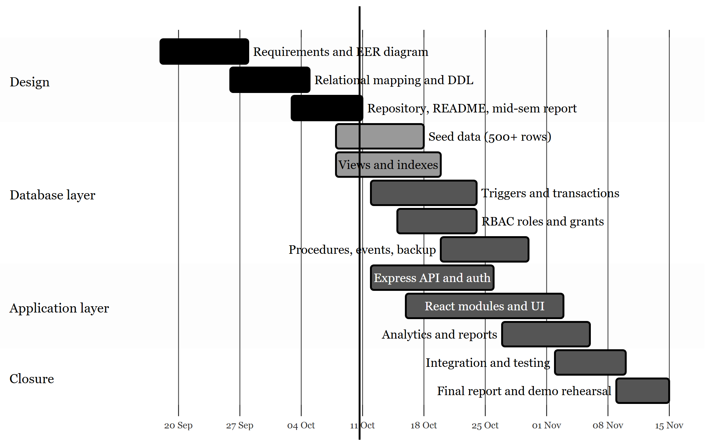

</details>

## Team and contributions

| Member | Roll number | Contribution |
|---|---|---|
| **Chaitrali Shrikant Dharmadhikari** | 2024A7PS0133H | Transactions, concurrency and integrity: triggers (`03_triggers_integrity.sql`), stored procedures and scheduled events (`05_stored_procs_events.sql`), expense approval screen, concurrent-approval tests |
| **Maddela Bhargava Krishna Reddy** | 2024A8PS0349H | Backend API and access control: `server/index.js`, connection pool, error mapping, REST routes, `04_rbac.sql`, login and user-management screens |
| **Lakshya Sachdeva** | 2024A8PS0468H | Schema and EER modelling: EER/ER diagrams, relational mapping, normalisation notes, `01_schema_er.sql`, seed data, README and integration |
| **Risha Sinha** | 2024A8PS0485H | Frontend: design system, app shell, sidebar, dashboard, Proposals, Projects, Milestones, Outputs, Grants and Departments screens, usability checks |
| **Arnav Gupta** | 2024A8PS0487H | Queries and analytics: views and indexes (`02_views_indexes.sql`), `EXPLAIN` review, queries Q1 to Q6, DBA console, analytics module, full-text matcher, backup and recovery notes |

<details>
<summary><b>Responsibility matrix</b> (● lead, ○ support or reviewer)</summary>

| Area | Chaitrali | Bhargava | Lakshya | Risha | Arnav |
|---|:-:|:-:|:-:|:-:|:-:|
| EER and relational schema | ○ | ○ | ● | ○ | ○ |
| Seed data and constraints | ○ |  | ● |  | ○ |
| Views and indexes |  |  | ○ |  | ● |
| Triggers and transactions | ● | ○ |  |  |  |
| Procedures and events | ● |  |  |  | ○ |
| RBAC and authentication | ○ | ● |  | ○ |  |
| REST API | ○ | ● | ○ |  | ○ |
| Frontend screens | ○ | ○ |  | ● | ○ |
| Analytics and reports |  |  |  | ○ | ● |
| Documentation and report | ○ | ○ | ● | ○ | ○ |

</details>

## Documentation

| Document | Contents |
|---|---|
| 📕 [Final design document (PDF)](docs/reports/Group-25_Database_Design.pdf) | The submission document: EER, schema, constraints, normalisation, decisions |
| 📗 [Mid-semester report (PDF)](docs/reports/Group-25_Midsem_Report.pdf) | The original design and plan |
| [ER / EER model](docs/er-model.md) | All diagrams and the relationship table |
| [Relational schema](docs/relational-schema.md) | Mapping, keys, constraints, normalisation, assumptions |
| [Data dictionary](docs/data-dictionary.md) | Every column of every table |
| [Business rules](docs/business-rules.md) | Rules, triggers, events, procedures, known limitations |
| [Workflows](docs/workflows.md) | Sequence diagrams and the screen-to-table map |
| [SQL queries and indexes](docs/queries.md) | Q1 to Q6, views, `EXPLAIN` findings |
| [REST API](docs/api.md) | Every route, role and error |
| [Access control](docs/rbac.md) | Roles, privilege matrix, database accounts |
| [Testing](docs/testing.md) | What is tested, what was checked by hand, what was not |
| [Backup and recovery](docs/backup-recovery.md) | Dump, restore, point-in-time recovery |

## Repository layout

```
DBMS-Project/
├── unigrant_schema.sql            One-step install (generated from schema/01 to 07)
├── schema/
│   ├── 01_schema_er.sql           Tables, keys, constraints
│   ├── 02_views_indexes.sql       Views and index strategy
│   ├── 03_triggers_integrity.sql  Triggers, transaction and isolation notes
│   ├── 04_rbac.sql                Roles, GRANT, REVOKE, accounts
│   ├── 05_stored_procs_events.sql Procedures, events, backup notes
│   ├── 06_seed_data.sql           Demo accounts and core story data
│   ├── 07_seed_bulk.sql           Bulk data (generated)
│   └── 08_queries.sql             Q1 to Q6 (generated)
├── server/
│   ├── index.js                   Express REST API
│   ├── queries.js                 Q1 to Q6, single source
│   └── test/                      Integration tests
├── src/
│   ├── api.js                     API client
│   ├── App.jsx                    App shell
│   ├── components/                Sidebar, UI kit, 3D schema scene
│   ├── lib/                       Data layer, navigation, schema model
│   ├── pages/                     One file per screen
│   └── styles/
├── scripts/                       Seed generator, SQL bundler, design PDF builder
└── docs/                          Everything linked above
```

## Known limitations

- Passwords use unsalted SHA-256, as designed. A production system would use bcrypt or Argon2.
- The API uses one pooled service account, so MySQL GRANTs protect direct database access, and the role guard protects API access.
- The Vercel configuration in `vercel.json` has not been tested, and needs a hosted MySQL server.

---

<div align="center">
<sub>Built by Group-25 for CS F212 Database Systems, BITS Pilani, Hyderabad Campus, 2026.</sub>
</div>