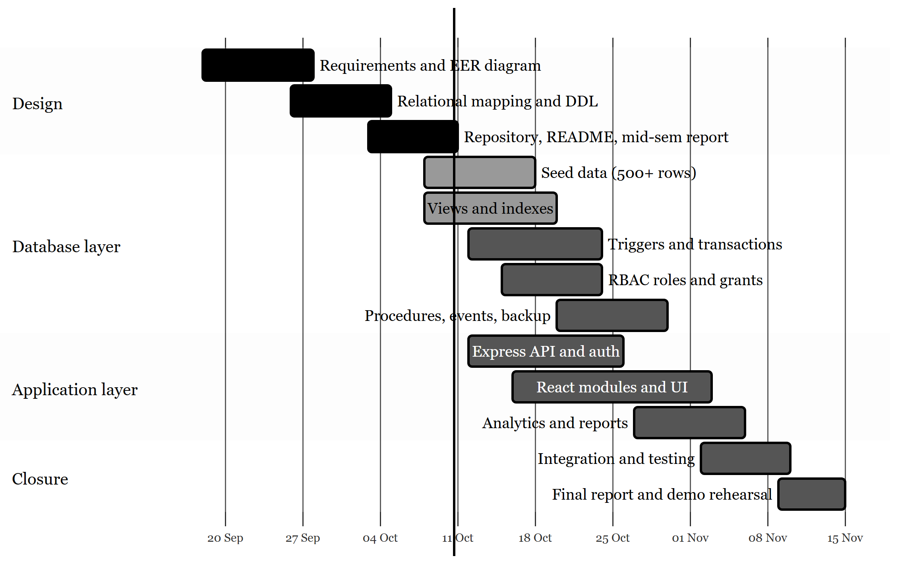
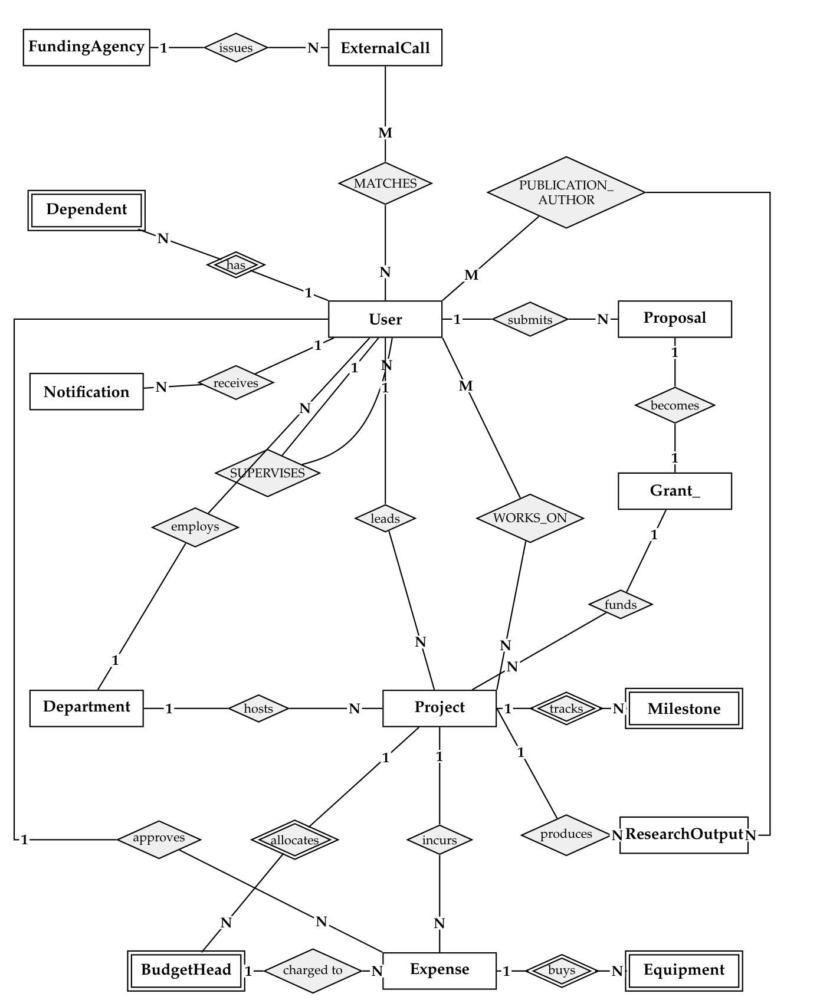
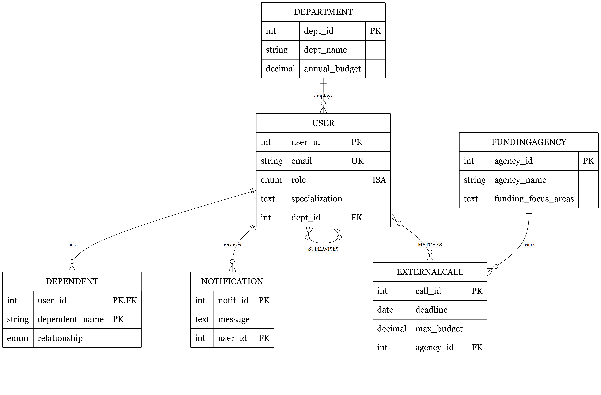
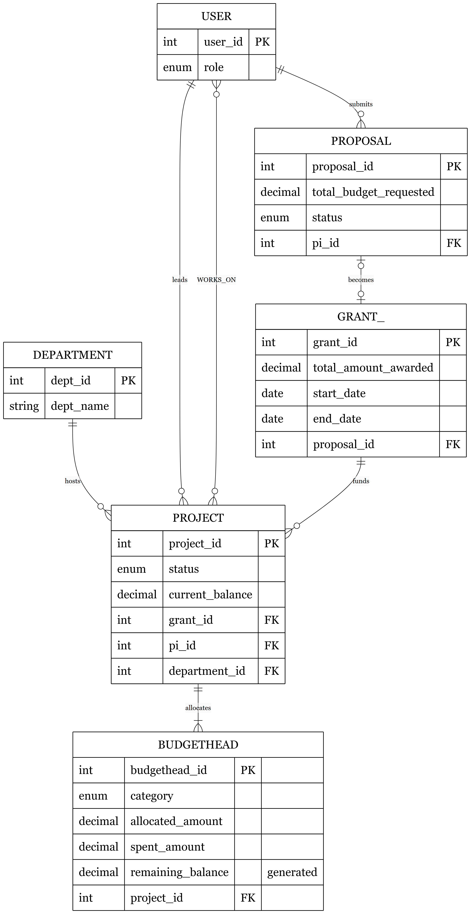
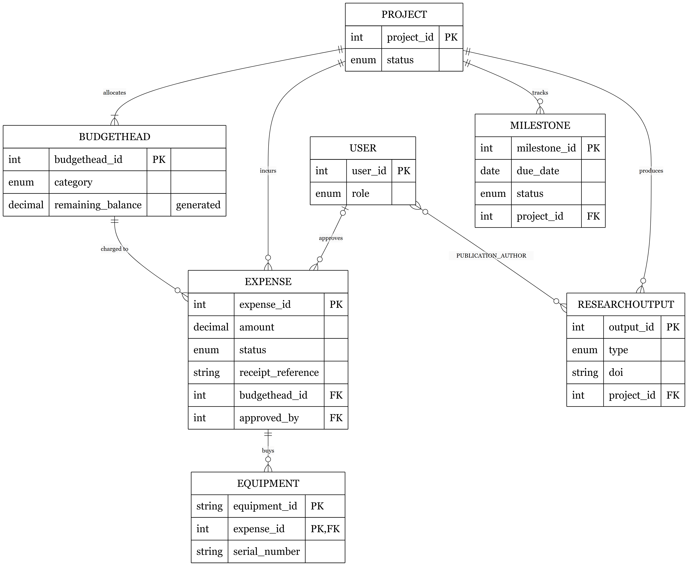
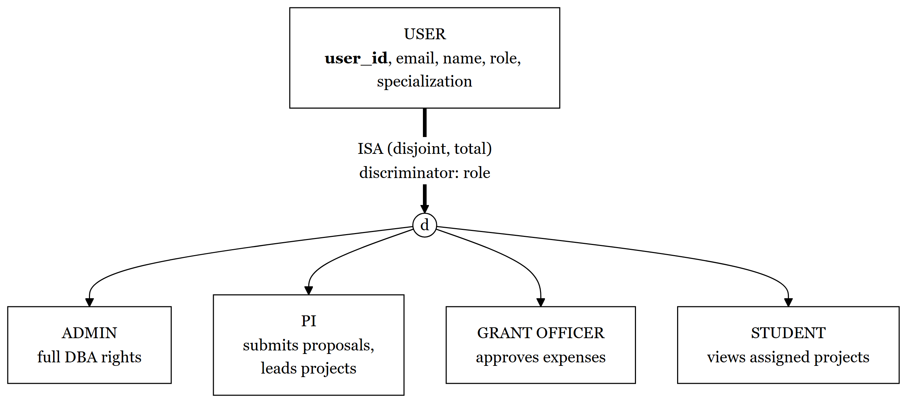
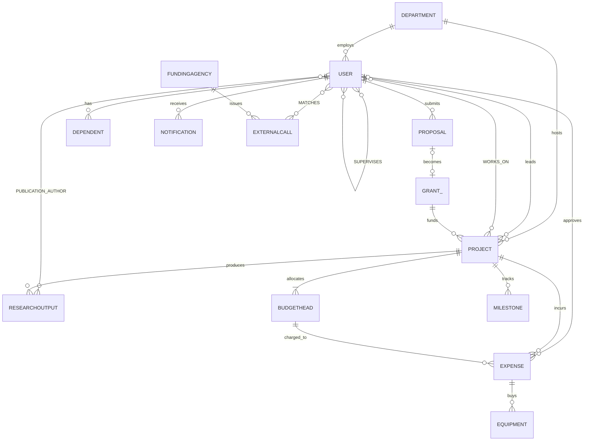

# UniGrant: Research Grant Lifecycle Management

**CS F212 Database Systems | BITS Pilani, Hyderabad Campus | Group-25**

UniGrant keeps the whole life of a university research grant in one relational database: proposal, review, award, projects, budget heads, expenses, milestones, publications and reports. The rules that matter most (no overspending a budget head, at most 5 active projects per PI, no duplicate receipts, no self-supervision) are enforced by the DBMS through constraints and triggers, so they hold no matter which client touches the data.

---

## Team and contributions

| Member | Roll number | Contribution |
|---|---|---|
| Chaitrali Shrikant Dharmadhikari | 2024A7PS0133H | Transactions, concurrency and integrity: triggers (`03_triggers_integrity.sql`), stored procedures and scheduled events (`05_stored_procs_events.sql`), expense approval screen, concurrent-approval tests |
| Maddela Bhargava Krishna Reddy | 2024A8PS0349H | Backend API and access control: `server/index.js`, connection pool, error mapping, REST routes, `04_rbac.sql`, login and user-management screens |
| Lakshya Sachdeva | 2024A8PS0468H | Schema and EER modelling: EER/ER diagrams, relational mapping, normalisation notes, `01_schema_er.sql`, seed data (`06_seed_data.sql`), README and integration |
| Risha Sinha | 2024A8PS0485H | Frontend: design system, app shell, sidebar, dashboard, Proposals, Projects, Milestones, Outputs, Grants and Departments screens, usability checks |
| Arnav Gupta | 2024A8PS0487H | Queries and analytics: views and indexes (`02_views_indexes.sql`), `EXPLAIN` review, DBA console, analytics module, full-text matcher, backup and recovery notes |

Responsibility matrix (● lead, ○ support or reviewer):

| Area | Chaitrali | Bhargava | Lakshya | Risha | Arnav |
|---|:-:|:-:|:-:|:-:|:-:|
| EER and relational schema | ○ | ○ | ● | ○ | ○ |
| Seed data and constraints | ○ |  | ● |  | ○ |
| Views and indexes |  |  | ○ |  | ● |
| Triggers and transactions | ● | ○ |  |  |  |
| Procedures and events | ● |  |  |  | ○ |
| RBAC and authentication | ○ | ● |  | ○ |  |
| REST API | ○ | ● | ○ |  | ○ |
| Frontend screens | ○ | ○ |  | ● | ○ |
| Analytics and reports |  |  |  | ○ | ● |
| Documentation and report | ○ | ○ | ● | ○ | ○ |

---

## Current progress (mid-semester)

Completed: requirements and business rules, the full EER/ER model (below), relational mapping, DDL with all keys and constraints, repository scaffold, mid-semester report. In progress: seed data, views and indexes, trigger drafts, API scaffold. Planned: remaining DB objects, React screens, analytics, integration and testing.

| Component | State |
|---|---|
| Requirements and business rules (BR1 to BR10) | Done |
| EER / ER model and relational mapping | Done |
| DDL: 19 relations, keys, 11 CHECK constraints | Done |
| Repository, README, mid-sem report | Done |
| Seed data (500+ rows) | In progress |
| Views and indexes | In progress |
| Triggers, transactions, RBAC | In progress |
| Express API and authentication | In progress |
| React screens | Planned |
| Analytics, backup and recovery notes | Planned |



---

## ER / EER modelling

The model has 12 strong entities, 3 weak or associative entities with composite keys (`Dependent`, `Equipment`, `PublicationAuthor`), 3 M:N relationships carrying attributes (`WORKS_ON`, `MATCHES`, recursive `SUPERVISES`) and one specialisation of `User` by `role`. `BudgetHead` and `Milestone` are existence-dependent on `Project` (NOT NULL foreign key, `ON DELETE CASCADE`).

### Chen notation (rectangles and diamonds)

Rectangles are entities, double rectangles are weak entities, diamonds are relationships, double diamonds are identifying relationships. Labels 1, N, M are cardinalities.



### Crow's foot EER views with attributes

Organisation, people and external funding:



Proposal to grant to project:



Spending, milestones and research outputs:



### Specialisation of User



The four roles (Admin, PI, Grant Officer, Student) differ in privileges, not stored attributes, so the hierarchy is a single table with a discriminator (`User.role`).

### Same model as an ER diagram (renders on GitHub)



### Relationship table

| Relationship | Participants | Cardinality | Notes |
|---|---|---|---|
| employs | Department, User | 1:N | dept nullable (SET NULL) |
| submits | User (PI), Proposal | 1:N | Proposal total |
| becomes | Proposal, Grant_ | 1:0..1 | `UNIQUE(proposal_id)` planned |
| funds | Grant_, Project | 1:N | Project partial |
| hosts | Department, Project | 1:N | |
| leads | User (PI), Project | 1:N | Project total |
| WORKS_ON | User, Project | M:N | role, hours/week, stipend |
| allocates | Project, BudgetHead | 1:N | BudgetHead existence-dependent |
| incurs | Project, Expense | 1:N | |
| charged to | BudgetHead, Expense | 1:N | |
| approves | User, Expense | 1:N | Expense partial |
| buys | Expense, Equipment | 1:N | Equipment weak |
| tracks | Project, Milestone | 1:N | Milestone existence-dependent |
| produces | Project, ResearchOutput | 1:N | |
| PUBLICATION_AUTHOR | User, ResearchOutput | M:N | author position, contribution |
| SUPERVISES | User, User | M:N | recursive, type, start date |
| MATCHES | ExternalCall, User | M:N | score 0 to 100, reason |
| issues | FundingAgency, ExternalCall | 1:N | |
| has | User, Dependent | 1:N | Dependent weak |
| receives | User, Notification | 1:N | |

---

## Relational schema

| Relation | Primary key | Foreign keys (ON DELETE) |
|---|---|---|
| Department | dept_id | none |
| User | user_id | dept_id → Department (SET NULL); UNIQUE email, ssn |
| FundingAgency | agency_id | none |
| ExternalCall | call_id | agency_id → FundingAgency (CASCADE) |
| Proposal | proposal_id | pi_id → User (RESTRICT) |
| Grant_ | grant_id | proposal_id → Proposal (SET NULL) |
| Project | project_id | department_id → Department (SET NULL); grant_id → Grant_ (SET NULL); pi_id → User (RESTRICT) |
| BudgetHead | budgethead_id | project_id → Project (CASCADE) |
| Expense | expense_id | budgethead_id → BudgetHead (RESTRICT); project_id → Project (CASCADE); approved_by → User (SET NULL) |
| Milestone | milestone_id | project_id → Project (CASCADE) |
| ResearchOutput | output_id | project_id → Project (CASCADE) |
| Notification | notif_id | user_id → User (CASCADE) |
| Dependent | (user_id, dependent_name) | user_id → User (CASCADE) |
| PublicationAuthor | (output_id, user_id) | output_id → ResearchOutput; user_id → User (CASCADE) |
| Equipment | (equipment_id, expense_id) | expense_id → Expense (CASCADE) |
| WORKS_ON | (user_id, project_id) | both CASCADE |
| SUPERVISES | (supervisor_id, supervisee_id) | both → User (CASCADE) |
| MATCHES | (call_id, user_id) | call_id → ExternalCall; user_id → User (CASCADE) |
| BudgetSnapshot | snapshot_id | none (archive written by a scheduled event) |

Key constraints: `DECIMAL(15,2)` for all money, `ENUM` for every status, 11 CHECK constraints (positive amounts, `end_date > start_date`, no self-supervision, score 0 to 100), and `BudgetHead.remaining_balance` as a stored generated column. The grant table is named `Grant_` because `GRANT` is a reserved word.

### Business rules enforced by the DBMS

| ID | Rule | Mechanism |
|---|---|---|
| BR1 | Expense cannot exceed the budget head's remaining balance | Trigger `balance_check_before_expense` |
| BR2 | Approval updates the budget head atomically | Trigger `update_budget_on_approval` in a transaction |
| BR3 | A PI has at most 5 active projects when proposing | Trigger `active_project_limit_pi` |
| BR4 | Receipt reference unique per project | Trigger `prevent_duplicate_expense_receipt` |
| BR5 | Dates ordered, amounts positive | CHECK constraints |
| BR6 | No self-supervision | CHECK `chk_no_self_supervise` |
| BR7 | Students see only assigned projects, no financial columns | Views |
| BR8 | Grant officers cannot create users | `REVOKE CREATE USER` |
| BR9 | Expired active grants auto-close | Event `grant_closure_check` |
| BR10 | 30-day milestone alert to PI | Event `milestone_30day_alert` |

---

## Architecture and technology stack

Front End ↔ Application ↔ Relational Database.

| Layer | Technology |
|---|---|
| Database | MySQL 8.0 (InnoDB) |
| Backend | Node.js, Express 4, `mysql2/promise` |
| Frontend | React 19, Vite 8 |
| Security | SHA-256 password hashing, role guard, MySQL roles (`admin_role`, `pi_role`, `grant_officer_role`, `student_role`) |

Planned workflows: **W1** award a grant (multi-table transaction), **W2** submit and approve an expense (integrity via triggers and a transaction), **W3** discover and report (full-text matching, views, CTEs).

---

## Repository layout

```
DBMS-Project/
  README.md
  docs/images/               diagram images
  schema/
    01_schema_er.sql         tables, keys, constraints
    02_views_indexes.sql     views and index strategy
    03_triggers_integrity.sql
    04_rbac.sql              roles, GRANT, REVOKE
    05_stored_procs_events.sql
    06_seed_data.sql
  server/                    Express API
  src/                       React client
```

## Setup (database)

```bash
mysql -u root -p < schema/01_schema_er.sql
mysql -u root -p < schema/02_views_indexes.sql
mysql -u root -p < schema/03_triggers_integrity.sql
mysql -u root -p < schema/04_rbac.sql
mysql -u root -p < schema/05_stored_procs_events.sql
mysql -u root -p < schema/06_seed_data.sql
```
