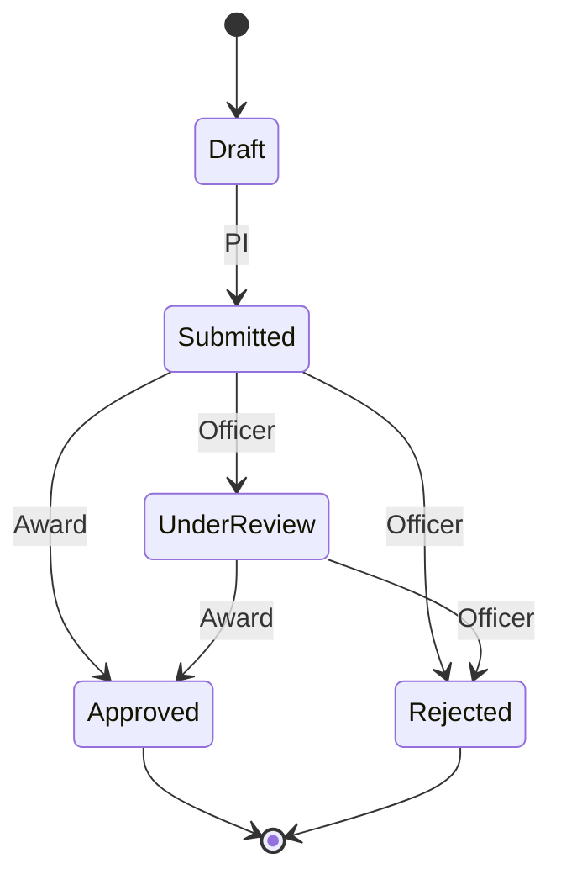

# REST API

Express 4 on port 3001, source in [`server/index.js`](../server/index.js). All bodies are JSON. Every route except health and login needs `Authorization: Bearer <token>`, where the token comes from login. Tokens are HMAC-SHA256 signed and last 8 hours.

## Authentication

| Method | Path | Roles | Purpose |
|---|---|---|---|
| GET | `/api/health` | Public | Database connectivity |
| POST | `/api/auth/login` | Public | Checks `SHA2(password, 256)`, returns the user and a token |

## Reads

Rows are narrowed to what the role may see.

| Method | Path | Roles | Row filter |
|---|---|---|---|
| GET | `/api/users` | All | Students get names only |
| GET | `/api/departments` | All | |
| GET | `/api/proposals` | Admin, Officer, PI | PI: own |
| GET | `/api/grants` | Admin, Officer, PI | |
| GET | `/api/projects` | All | PI: own. Student: `Student_Project_View` |
| GET | `/api/budget-heads` | Admin, Officer, PI | PI: own projects |
| GET | `/api/expenses` | Admin, Officer, PI | PI: own projects |
| GET | `/api/milestones` | All | |
| GET | `/api/research-outputs` | All | |
| GET | `/api/external-calls` | All | |
| GET | `/api/works-on` | All | Student: own |

## Workflow W1

| Method | Path | Roles | Purpose |
|---|---|---|---|
| POST | `/api/proposals` | PI, Admin | Create a Draft |
| PATCH | `/api/proposals/:id/status` | PI, Officer, Admin | Move along the life cycle |
| POST | `/api/grants/award` | Officer, Admin | Transaction over four tables |

Proposal life cycle:



Award request:

```json
{
  "proposal_id": 5,
  "funding_agency": "Indian Council of Medical Research",
  "agency_contact_info": "extramural@icmr.org.in",
  "reporting_frequency": "Quarterly",
  "start_date": "2026-12-01",
  "end_date": "2028-11-30",
  "budget_heads": [
    { "category": "Equipment", "allocated_amount": 640000 },
    { "category": "Manpower", "allocated_amount": 960000 }
  ]
}
```

## Workflow W2

| Method | Path | Roles | Purpose |
|---|---|---|---|
| POST | `/api/expenses` | PI, Admin | Pending expense, checked by the triggers |
| PATCH | `/api/expenses/:id/approve` | Officer, Admin | Locked ACID approval |
| PATCH | `/api/expenses/:id/reject` | Officer, Admin | Reject, or reverse an approval |

## Workflow W3

| Method | Path | Roles | Purpose |
|---|---|---|---|
| GET | `/api/search?q=topic` | Admin, Officer, PI | FULLTEXT over researchers and proposals |
| POST | `/api/match/:userId` | PI (own), Admin | Score open calls, store in `MATCHES` |
| GET | `/api/reports/analytics` | Admin | `Admin_Analytics_View` |
| GET | `/api/reports/pi-dashboard` | PI | `PI_Dashboard_View` for the caller |
| GET | `/api/reports/department/:id` | Admin | `CALL generate_annual_report(id)` |
| GET | `/api/reports/queries` | Admin | Catalogue of Q1 to Q6 |
| GET | `/api/reports/queries/:id` | Admin | Runs one query, `?term=` for Q5 |

## Errors

Database errors become HTTP responses, so the client sees the database's reason. Errors have the shape `{ "error": "message", "code": "BUSINESS_RULE" }`.

| Status | Meaning | Source |
|---|---|---|
| 400 | Bad input or missing reference | Validation, FK error 1452, NOT NULL error 1048 |
| 401 | No valid session | Token check |
| 403 | Role may not do this | Role guard |
| 404 | No such row | Route |
| 409 | Conflict with current state | Duplicate key, illegal status change, row still referenced |
| 422 | A business rule refused it | SQLSTATE 45000, CHECK error 3819 |
| 500 | Unexpected database error | Logged on the server, generic message to the client |

## Example

```bash
curl -X POST localhost:3001/api/auth/login \
  -H "Content-Type: application/json" \
  -d '{"email":"sneha@university.edu","password":"go123"}'

curl -X PATCH localhost:3001/api/expenses/5/approve \
  -H "Authorization: Bearer <token>"
```
