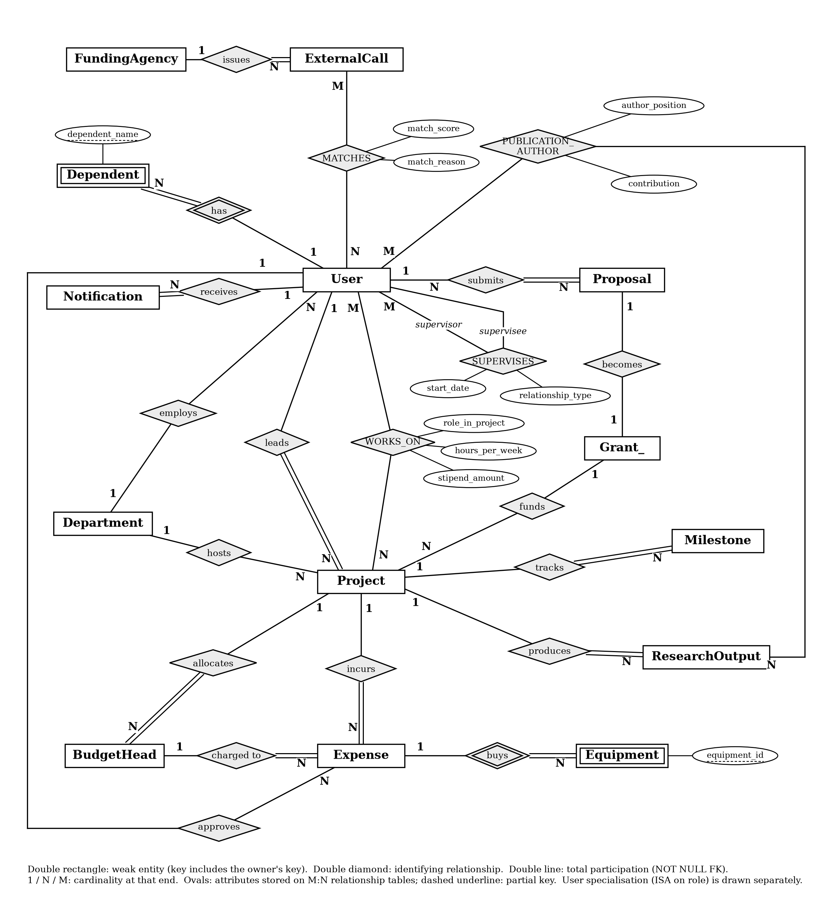
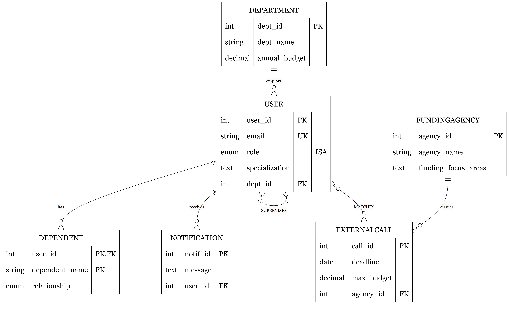
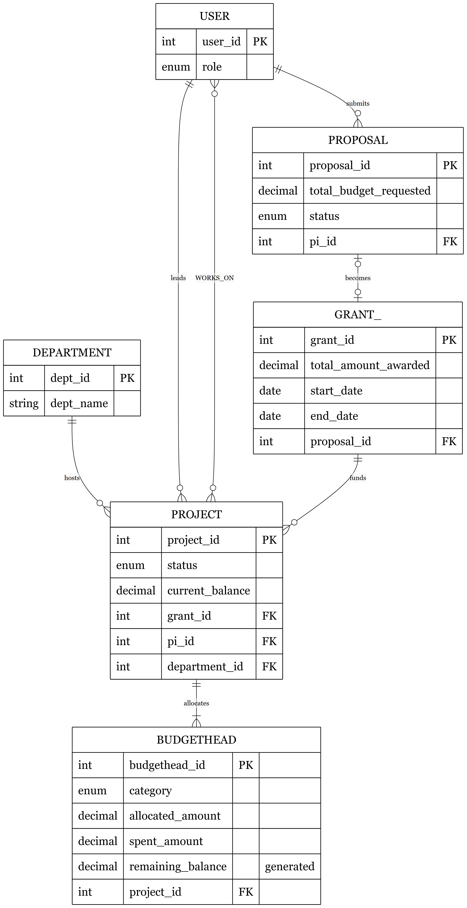
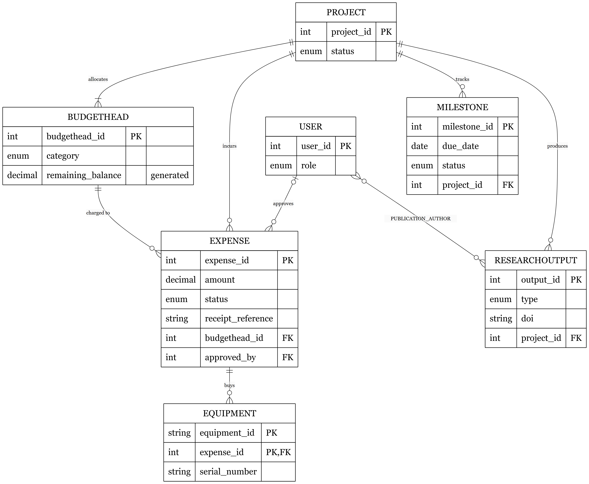
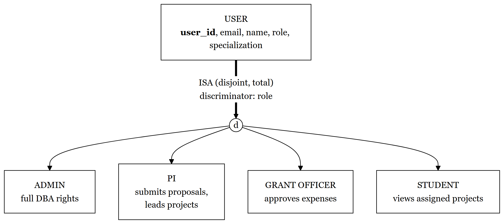
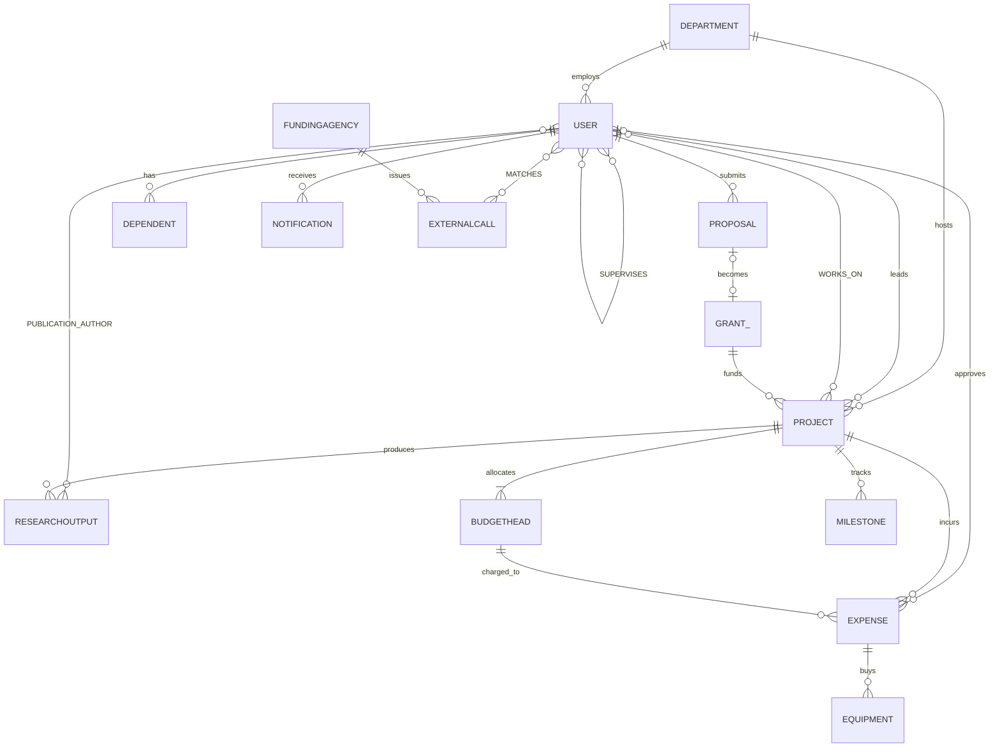

# ER / EER model

The model has 12 strong entities, 3 weak or associative entities with composite keys (`Dependent`, `Equipment`, `PublicationAuthor`), 3 M:N relationships carrying attributes (`WORKS_ON`, `MATCHES`, recursive `SUPERVISES`) and one specialisation of `User` by `role`. `BudgetHead` and `Milestone` are existence-dependent on `Project` (NOT NULL foreign key, `ON DELETE CASCADE`).

## Chen notation

Rectangles are entities, double rectangles are weak entities, diamonds are relationships, double diamonds are identifying relationships. Labels 1, N and M are cardinalities.

## Crow's foot views with attributes

The full model is too large for one readable page, so it is split into three views.

**Organisation, people and external funding**

**Proposal to grant to project**

**Spending, milestones and research outputs**

## Specialisation of User

The four roles (Admin, PI, Grant Officer, Student) differ in privileges, not in stored attributes, so the disjoint, total hierarchy maps to a single table with the discriminator `User.role`.

## The same model as an ER diagram

This version renders natively on GitHub.

## Relationships

| Relationship | Participants | Cardinality | Notes |
|---|---|---|---|
| employs | Department, User | 1:N | `dept_id` nullable (SET NULL) |
| submits | User (PI), Proposal | 1:N | Proposal total |
| becomes | Proposal, Grant_ | 1:0..1 | `UNIQUE (proposal_id)` |
| funds | Grant_, Project | 1:N | Project partial |
| hosts | Department, Project | 1:N | |
| leads | User (PI), Project | 1:N | Project total |
| WORKS_ON | User, Project | M:N | role, hours per week, stipend |
| allocates | Project, BudgetHead | 1:N | BudgetHead existence-dependent |
| incurs | Project, Expense | 1:N | |
| charged to | BudgetHead, Expense | 1:N | |
| approves | User, Expense | 1:N | Expense partial |
| buys | Expense, Equipment | 1:N | Equipment weak |
| tracks | Project, Milestone | 1:N | Milestone existence-dependent |
| produces | Project, ResearchOutput | 1:N | |
| PUBLICATION_AUTHOR | User, ResearchOutput | M:N | author position, contribution |
| SUPERVISES | User, User | M:N | recursive, type, start date |
| MATCHES | ExternalCall, User | M:N | score 0 to 100, reason, computed at |
| issues | FundingAgency, ExternalCall | 1:N | |
| has | User, Dependent | 1:N | Dependent weak |
| receives | User, Notification | 1:N | |

The Chen diagram source is [`diagrams/chen_notation.py`](diagrams/chen_notation.py).
