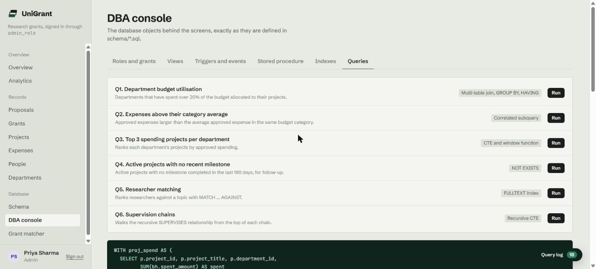

# SQL queries, views and indexes

## Analytical queries

The text is in [`schema/08_queries.sql`](../schema/08_queries.sql), generated from [`server/queries.js`](../server/queries.js), the same source the API runs. Run them from the DBA console's Queries tab, or:

```bash
mysql -u root -p < schema/08_queries.sql
```

| ID | Question | Concept | Rows on the seed |
|---|---|---|---|
| Q1 | Which departments have spent over 20% of their budget? | Multi-table join, GROUP BY, HAVING | 5 |
| Q2 | Which approved expenses exceed their category's average? | Correlated subquery | 25 (LIMIT) |
| Q3 | What are the top 3 spending projects per department? | CTE, `RANK() OVER` | 21 |
| Q4 | Which active projects have no milestone completed in 180 days? | NOT EXISTS | 5 |
| Q5 | Which researchers fit a topic? | FULLTEXT | Depends on the term |
| Q6 | What are the supervision chains? | Recursive CTE | 40 (LIMIT) |

Q3 is the example from the design report:

```sql
WITH proj_spend AS (
  SELECT p.project_id, p.project_title, p.department_id,
         SUM(bh.spent_amount) AS spent
  FROM Project p
  JOIN BudgetHead bh ON bh.project_id = p.project_id
  GROUP BY p.project_id, p.project_title, p.department_id
)
SELECT r.department_id, d.dept_name, r.project_title, r.spent, r.rnk
FROM (SELECT ps.*,
             RANK() OVER (PARTITION BY department_id ORDER BY spent DESC) AS rnk
      FROM proj_spend ps) r
JOIN Department d ON d.dept_id = r.department_id
WHERE r.rnk <= 3
ORDER BY r.department_id, r.rnk;
```



## Views

| View | Purpose | Readers |
|---|---|---|
| `Public_Project_View` | Project facts with no money columns | Admin, PI, Grant Officer, Student |
| `PI_Dashboard_View` | Per-project utilisation, open milestones, team size | Admin, PI |
| `Admin_Analytics_View` | Funding, projects, outputs and students per department | Admin |
| `Student_Project_View` | One row per assignment, no money columns | Admin, Student |

### Avoiding join fan-out

Joining several one-to-many tables in one `FROM` clause multiplies the rows, and every `SUM` is inflated. An earlier version of `Admin_Analytics_View` showed ₹50 L of funding for a ₹25 L grant because the grant row was repeated once per team member, and `generate_annual_report` showed ₹1.5 Cr.

The fix pre-aggregates each measure in its own derived table, one row per department, before joining:

```sql
LEFT JOIN (
  SELECT department_id, SUM(total_amount_awarded) AS total_funding
  FROM (SELECT DISTINCT p.department_id, g.grant_id, g.total_amount_awarded
        FROM Project p JOIN Grant_ g ON p.grant_id = g.grant_id) dg
  GROUP BY department_id
) fund ON fund.department_id = d.dept_id
```

`DISTINCT` counts a grant once even when it funds several projects in the department (assumption A2).

## Indexes

InnoDB clusters each table on its primary key. These are the secondary indexes.

| Index | Type | Columns | Query it serves |
|---|---|---|---|
| `IDX_Project_Title_Status` | B-tree | `project_title, status` | Project list with status filter |
| `IDX_User_Name` | B-tree | `last_name, first_name` | Name lookup |
| `IDX_Expense_Date_Project` | B-tree | `date, project_id` | Expense timelines |
| `IDX_Milestone_Status_DueDate` | B-tree | `status, due_date` | 30-day alert event |
| `FT_Proposal` | FULLTEXT | `abstract, title` | Proposal search |
| `FT_User_Specialization` | FULLTEXT | `specialization` | Researcher matching |

### EXPLAIN results

Measured on MySQL 8.0.46 with the seed data.

| Query | `type` | `key` | Reading |
|---|---|---|---|
| `Project WHERE status = 'Active' ORDER BY project_title` | index | `IDX_Project_Title_Status` | Covering index scan, no filesort |
| `User WHERE last_name = ? AND first_name = ?` | ref | `IDX_User_Name` | Both key parts used, 1 row |
| `Milestone WHERE status = 'Pending' AND due_date BETWEEN ...` | range | `IDX_Milestone_Status_DueDate` | Equality then range, the ideal order |
| `User WHERE MATCH(specialization) AGAINST (...)` | fulltext | `FT_User_Specialization` | Inverted index |
| `Expense WHERE date BETWEEN ... AND project_id = ?` | ref | `project_id` | See below |

**Finding.** For the expense query, the optimiser prefers the foreign-key index on `project_id` to `IDX_Expense_Date_Project`. The composite index starts with `date`, a range column, so it cannot use `project_id` to narrow the scan. Reversing it to `(project_id, date)` would put the equality column first, which is the same order that makes the milestone index work. The index is kept as the design report defined it, and this is recorded as a tuning option.

## Other features used

Generated columns, ENUM domains, `ON DUPLICATE KEY UPDATE`, `SIGNAL SQLSTATE`, `SELECT ... FOR UPDATE`, window functions, recursive CTEs, MySQL roles and column-level privileges.
