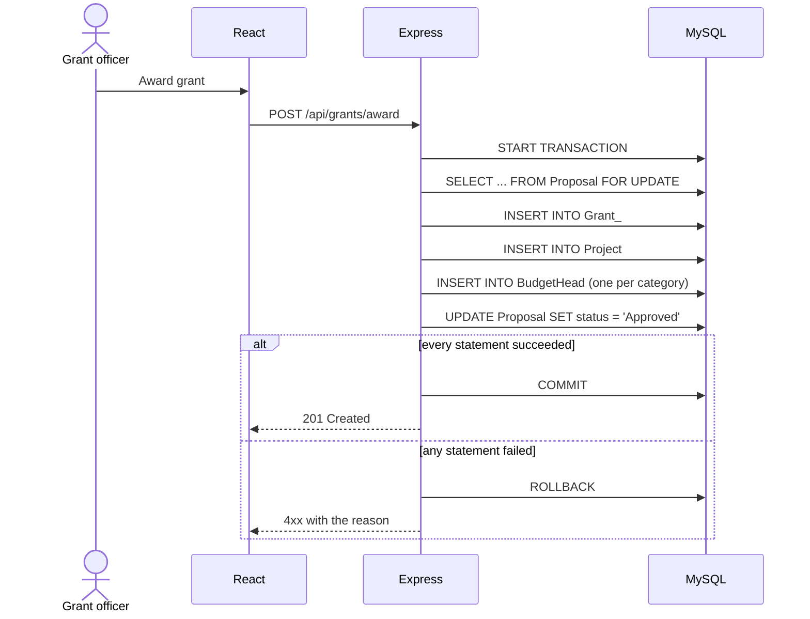
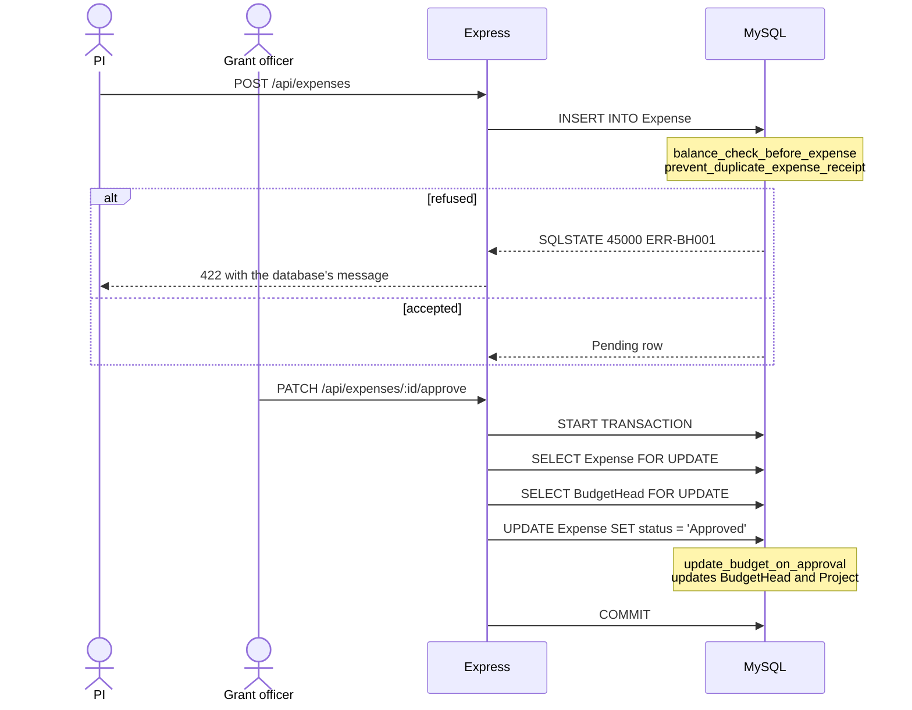
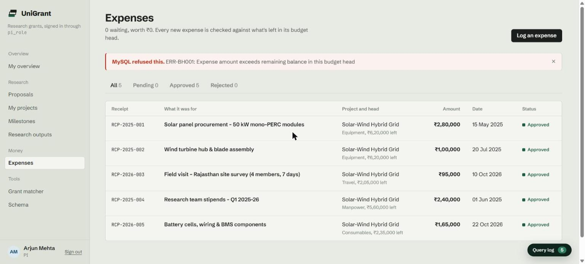

# Application workflows

Three end-to-end workflows, each exercising a different part of the database.

| | Workflow | Exercises | Screens |
|---|---|---|---|
| **W1** | Award a grant | Multi-table transaction | Proposals |
| **W2** | Submit and approve an expense | Integrity enforcement, concurrency | Expenses |
| **W3** | Discover and report | Complex retrieval, search, aggregation | Grant matcher, Analytics, DBA console |

## W1: award a grant

A PI drafts and submits a proposal. A grant officer reviews it and awards it. One transaction approves the proposal and creates the grant, the project and its budget heads. Any failure rolls all of it back.

| Tables | `Proposal`, `Grant_`, `Project`, `BudgetHead` |
|---|---|
| Demonstrates | Atomicity, row locks, `UNIQUE (proposal_id)` allowing one grant per proposal |
| Try it | Sign in as Sneha, open Proposals, choose **Award grant** on an Under Review proposal |

## W2: submit and approve an expense

A PI logs an expense. The triggers may refuse it. A grant officer approves it, and the trigger moves the money in the same transaction.

| Tables | `Expense`, `BudgetHead`, `Project` |
|---|---|
| Demonstrates | Triggers, SQLSTATE error mapping, `SELECT ... FOR UPDATE`, a CHECK as a backstop |
| Try it | Sign in as Arjun, log an expense for ₹99,99,999 and read the refusal, then sign in as Sneha and approve a pending expense |

## W3: discover and report

| Feature | Backed by |
|---|---|
| Researchers for a topic | `MATCH ... AGAINST` over `FT_User_Specialization` and `FT_Proposal` |
| Calls for a researcher | FULLTEXT relevance per open call, stored in `MATCHES` |
| Analytics | `Admin_Analytics_View` |
| Annual report | `CALL generate_annual_report(dept_id)` |
| Query runner | Q1 to Q6 in the DBA console |

Match scores are FULLTEXT relevance scaled so the best call scores 100, which keeps `match_score` inside its CHECK range of 0 to 100.

| Try it | Sign in as Priya, open DBA console, then the Queries tab, and run Q1 to Q6 |
|---|---|

## Screen to database map

| Screen | Roles | Objects |
|---|---|---|
| Overview | All | `Project`, `BudgetHead`, `Milestone`, `Expense`, `Student_Project_View` for students |
| Proposals | Admin, PI, Grant Officer | `Proposal`, W1 transaction, `active_project_limit_pi` |
| Projects | Admin, PI, Student | `Project`, `BudgetHead`, `WORKS_ON`, `Milestone` |
| Expenses | Admin, PI, Grant Officer | `Expense`, W2 transaction, three triggers |
| Grants | Admin, Grant Officer | `Grant_` |
| Milestones | PI, Student | `Milestone` |
| Research outputs | PI, Student | `ResearchOutput` |
| People, Departments | Admin | `User`, `Department` |
| Analytics | Admin | `Admin_Analytics_View` |
| DBA console | Admin | Everything in `schema/`, read straight from the SQL files |
| Grant matcher | Admin, PI | `MATCHES`, FULLTEXT indexes |
| Schema | All | Interactive 3D Chen-notation model |
